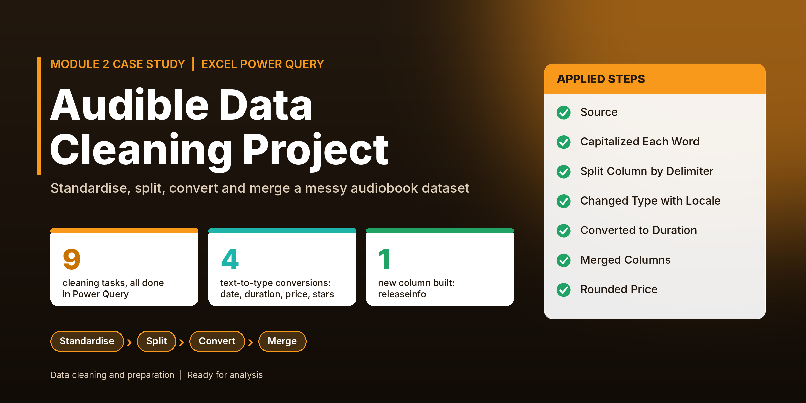

<h1 align="center">Audible — Data Cleaning Project with Excel Power Query</h1>

<p align="center">
  
  
  
  
</p>

<p align="center">
  
</p>

## Overview

A Module 2 case study that uses the Power Query Editor in Excel to clean and standardise a dataset of Audible audiobook listings. The messy text columns (titles, authors, dates, durations, prices, ratings and narrators) are formatted, split, converted and merged so the dataset is ready for analysis. The work covers nine tasks:

- **Standardise** — consistent title casing for `name`, one price format with two decimal places
- **Split** — multiple authors and multiple narrators into separate columns
- **Convert** — `releasedate` to DD-MM-YYYY, `time` to a duration, `price` to numbers, `stars` to numeric ratings
- **Merge** — `releasedate` and `language` into a new `releaseinfo` column

## The Dataset

One row per audiobook. The columns this project works on:

| Column | What needs cleaning |
|---|---|
| `name` | Mixed casing across titles |
| `author` | Several authors combined in one cell |
| `narratedby` | Several narrators combined in one cell |
| `releasedate` | Inconsistent date formats |
| `time` | Duration stored as text |
| `price` | Possible non-numeric values and uneven decimals |
| `stars` | Rating stored as text |
| `language` | Used to build `releaseinfo` |

## Tech Stack

```
Microsoft Excel
└── Power Query Editor     → Every step is recorded under Applied Steps
    ├── Transform tab      → Capitalize Each Word, Split Column, Data Type
    ├── Add Column tab     → Custom columns (duration, numeric stars, releaseinfo)
    └── M formulas         → Text, Date, Duration and Number functions
```

## Tasks & Approach

Each task is one recorded Applied Step, so the whole clean can be refreshed on a new copy of the data. The M snippets below are the approach I used as a starting point. Column names are assumed to match the table above, and the exact text patterns (for example how `time` and `stars` are written) should be confirmed against the file.

| # | Task | Approach in Power Query |
|---|---|---|
| 1 | Consistent title casing in `name` | Transform → Format → **Capitalize Each Word**, or `Table.TransformColumns(Source, {{"name", Text.Proper, type text}})` |
| 2 | Separate multiple authors | Split Column → **By Delimiter** (comma) → at each occurrence, giving `author.1`, `author.2` and so on |
| 3 | `releasedate` as DD-MM-YYYY | Change type to **Date using Locale** (English, India or UK) so day and month are read correctly, then format as `dd-MM-yyyy` |
| 4 | `time` as a duration | Add a custom column that reads hours and minutes from the text and builds `#duration(0, hours, minutes, 0)`, typed as Duration |
| 5 | `price` numeric, flag non-numeric | Change type to Decimal Number; use **Keep Errors** to list the rows that fail, then decide whether to treat them as null or as zero |
| 6 | Text ratings in `stars` as numbers | Extract the leading number from the text with a custom column and type it as Decimal Number |
| 7 | Split `narratedby` | Same split-by-delimiter approach as authors |
| 8 | Merge into `releaseinfo` | Custom column: `Date.ToText([releasedate], "dd-MM-yyyy") & ", " & [language]`, done while `releasedate` is still a date |
| 9 | Two-decimal prices | `Number.Round([price], 2)` and set the Excel number format to `0.00` on load |

**M snippets**

```
// Task 4: duration from text such as "2 hrs and 20 mins" (pattern assumed)
= Table.AddColumn(Prev, "duration", each
    let
        t    = Text.Lower([time]),
        hrs  = if Text.Contains(t, "hr") then Number.From(Text.BeforeDelimiter(t, " hr")) else 0,
        rest = if Text.Contains(t, "and ") then Text.AfterDelimiter(t, "and ") else t,
        mins = if Text.Contains(t, "min") then Number.From(Text.BeforeDelimiter(rest, " min")) else 0
    in #duration(0, hrs, mins, 0), type duration)

// Task 5: flag non-numeric prices
= Table.AddColumn(Prev, "price_is_numeric", each (try Number.From([price]) otherwise null) <> null, type logical)

// Task 6: numeric rating from text such as "5 out of 5 stars" (pattern assumed)
= Table.AddColumn(Prev, "stars_num", each try Number.From(Text.BeforeDelimiter([stars], " out of")) otherwise null, type number)
```

**Order matters.** Build `releaseinfo` (task 8) before turning `releasedate` into text, split author and narrator columns before changing types, and round prices last.

## How to Use

1. Clone or download this repository.
2. Open `Audible_Cleaned.xlsx` in Microsoft Excel (2016 or later).
3. Go to Data → Queries & Connections and open the query to see every Applied Step.
4. Replace the source with a new copy of the data and choose Refresh to repeat the clean.

## Repository Structure

```
audible-power-query-cleaning
├── Audible_Cleaned.xlsx       ← Cleaned dataset with the Power Query steps (add your file here)
├── Audible_Case_Study.pdf     ← Slides with screenshots and explanations (add your file here)
├── cover.png                  ← Repo cover image
└── README.md
```

---

## About Me

**Anmol Agarwal**
Business Analyst

[](https://www.linkedin.com/in/anmol-agarwal123/)
[](https://github.com/Anmolagarwal19)
[](mailto:agarwalanmol799@gmail.com)

*If this project was useful, a star on the repo is appreciated — feel free to reach out for feedback, questions, or opportunities.*
